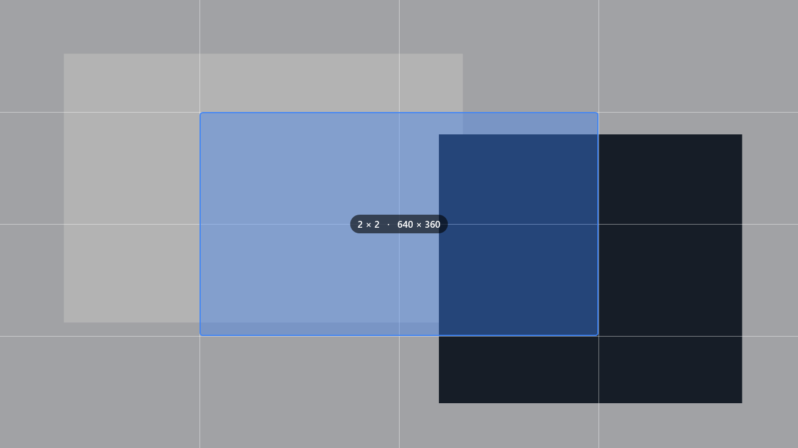
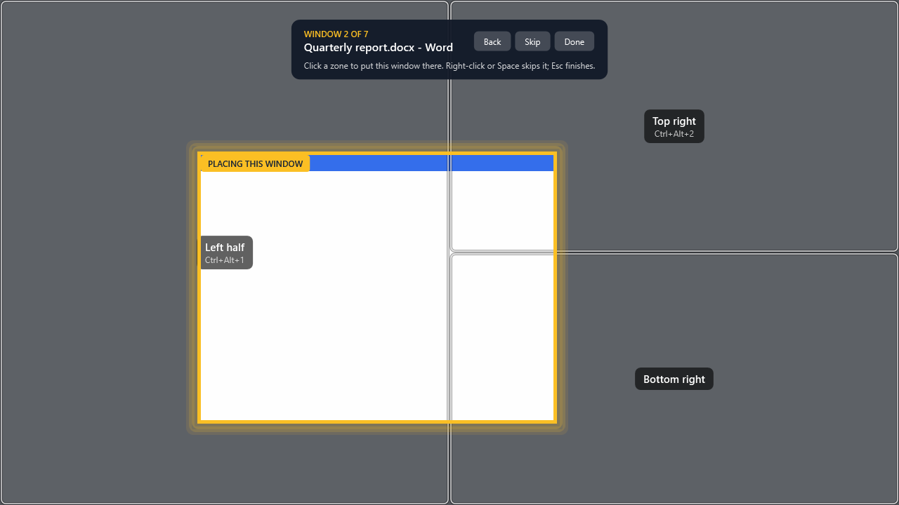

# Mullion

Place windows on a grid with the mouse, on Windows 10 and 11.

A *mullion* is the bar that divides a window into panes. Mullion divides your
screen the same way: drag a window, right-click, and stretch it over the cells
you want.



Mullion is a free, open-source take on the right-click-while-dragging gesture of
the discontinued WindowGrid by Joshua Wilding. It shares no code with it.

## How to use it

1. Start dragging a window by its title bar, as usual.
2. While still holding the left button, **press the right button**. The grid
   appears and the window returns to where it was.
3. Keep the right button down to move the first corner; **release it** to fix
   that corner.
4. Move the mouse to stretch the selection over more cells.
5. **Release the left button.** The window fills the selection.

A quick right-click followed by releasing the left button puts the window on the
single cell under the cursor.

While the grid is showing:

| Input | Effect |
|---|---|
| Mouse wheel | Makes the grid finer or coarser for this placement |
| Right-click again | Picks a new first corner |
| Esc | Cancels; the window stays where it was |

Ordinary dragging and Windows' own edge snapping are untouched unless you
right-click.

### Move on the grid without resizing

Hold **Ctrl** while dragging a window and it snaps to the nearest grid line when
you let go, keeping its size. The key can be changed or switched off in the
settings.

### Zones and keyboard shortcuts

A zone is a part of the screen with a keyboard shortcut. Press the shortcut and
the active window moves there, without touching the mouse.

Open **Settings… → Zones → Add zone…**, then:

1. Choose the zone's grid. Each zone has its own, so "left third" (3 × 1) and
   "top-right quarter" (2 × 2) can live side by side.
2. Drag across the picture to select the cells.
3. Click the shortcut box and press the keys, for example `Ctrl+Alt+1`. A
   shortcut needs Ctrl, Alt or the Windows key.

You can have as many zones as you like. With more than one monitor, pressing a
shortcut again moves the window to the same zone on the next monitor; this can
be switched off on the Zones tab.

If another program has already registered the shortcut you choose, Mullion warns
you and then takes it over: while Mullion is running, the shortcut moves the
window and the other program does not receive it. The zone list marks such
shortcuts. Pausing or exiting Mullion gives the shortcut back.

### Arrange windows one by one

When many windows need a place, let Mullion walk you through them. Choose
**Arrange windows…** from the tray icon's menu, or give it a shortcut under
**Settings… → Zones**.



Mullion brings the first open window to the front and makes it unmistakable: the
rest of the screen goes dark, and the window keeps its brightness, gets an amber
glow that flashes for a moment, and carries a "placing this window" tag. Your
zones are drawn on every monitor. Then, for each window in turn:

| Input | Effect |
|---|---|
| Click a zone | Puts the window there (on the monitor you clicked) and moves on |
| A zone's own shortcut | Does the same from the keyboard |
| Right-click, Space or **Skip** | Leaves the window where it is and moves on |
| Left arrow or **Back** | Goes back to the previous window |
| Esc, **Done** or the arrange shortcut again | Finishes |

Where zones overlap, the one whose centre is nearest the mouse is chosen, so
moving towards the middle of a zone always selects it. Minimized windows are
left alone. When arranging ends, the windows go back to the front-to-back order
they had before, so only their positions have changed. You need at least one zone; the zones are what you
click.

### Rules: windows that open where you want them

A rule puts a program's windows in a place as soon as they open.

**Mullion remembers for you.** Whenever you place a window with Mullion (the
grid gesture, a zone shortcut, or arranging windows), it remembers the place
twice: for that window's exact title, and for the program as a whole. When a
window opens:

1. If its title was placed before, it returns to that title's own place.
2. Otherwise it goes where the program's last window was put.

So with several windows of one program, each one you have placed comes back to
its own spot, and a brand-new one has somewhere sensible to open. Some programs
give a window its title only after it has appeared; Mullion looks a second time
a moment later, so such a window may first land in the program's place and then
move to its own. A title that is different next time (a browser tab, another
document) simply uses the program's place. Mullion keeps the 20 most recently
placed titles per program.

Remembered placements appear on the Rules tab with a "Remembered" label; there
you can switch one off, delete it, forget them all, or untick **Remember where I
place a window** to stop remembering. Editing a remembered placement turns it
into a rule of your own, which Mullion no longer changes. Remembered titles are
stored as plain text in `settings.json`.

**You can also write rules.** A rule you wrote always wins over a remembered
placement, and Mullion never changes it. Open **Settings… → Rules → Add rule…**
and choose:

- **Program**: its name as Task Manager shows it, for example `notepad++`. Pick
  one of the windows that are open now to have it filled in.
- **Title contains** (optional): part of a window title, to pick out particular
  windows of the program. Leave it empty for all of them.
- **Zone** and **Monitor**: where the window goes. The monitor can be the one the
  window happens to open on, or a particular one.

When several rules match, the one that asks for the most title text wins, so a
rule for one document beats the general rule for its program. Each rule can be
switched off with its tick box, and **Apply to open windows now** places
everything that is already open.

A window is placed once, when it first appears; if you move it afterwards,
Mullion leaves it there. Rules need the zone they point at: deleting that zone
leaves the rule in the list, marked, until you point it at another.

### Exclusions: programs to leave alone

Some programs are better left untouched: a game, a remote-desktop window, a tool
that manages its own windows. List them under **Settings… → Exclusions** (pick
one that has a window open, or type its name as Task Manager shows it) and
Mullion ignores them completely: no grid when you drag their windows, no zone
shortcuts, no arranging, and nothing is remembered or placed for them.

One thing an exclusion cannot do: a zone shortcut pressed while an excluded
program is active still does nothing there, because Mullion owns that key
combination while it runs.

## Settings

Right-click the Mullion icon in the notification area and choose **Settings…**
(or double-click the icon).

- **Grid**: number of columns and rows, from 1 to 100 each (the same grid is
  used on every monitor); the gap between neighbouring windows and the gap at
  the screen edges (zero means windows sit flush); and the key for moving on
  the grid.
- **Zones**: the saved zones and their shortcuts, and the shortcut for arranging
  windows one by one.
- **Rules**: which programs' windows go to which zone when they open.
- **Exclusions**: programs Mullion leaves alone.
- **Appearance**: colour and opacity of the tint, the grid lines and the
  selection.
- **General**: start Mullion when you sign in to Windows.

The menu also has **Pause**, which switches the gestures off until you untick it.

## Portable

Mullion is a single executable. It keeps `settings.json` (and `mullion.log`, if
something goes wrong) in the folder it runs from, so put it somewhere you can
write to. The only thing stored elsewhere is the optional start-with-Windows
entry in the registry.

Two versions are published:

| File | Size | Needs |
|---|---|---|
| `Mullion.exe` | small | the [.NET 10 Desktop Runtime](https://dotnet.microsoft.com/download/dotnet/10.0) |
| `Mullion-full.exe` | large | nothing |

## Good to know

- Run only one grid tool at a time. Another tool that reacts to the same mouse
  gesture (the original WindowGrid, for example) will fight Mullion for it.
- Windows started "as administrator" can only be moved if Mullion itself runs as
  administrator.
- Some windows refuse certain sizes; Mullion moves those as close as they allow.

## Building from source

Requires the [.NET 10 SDK](https://dotnet.microsoft.com/download/dotnet/10.0).

```powershell
dotnet build
dotnet test tests/Mullion.Core.Tests
dotnet run --project src/Mullion
```

`build.ps1` runs the tests and writes both release executables to `dist\`.

`tests/Mullion.GestureProbe` checks the app end to end by driving the real mouse
and keyboard against a window of its own. It takes over the mouse for a few
seconds.

- Gestures: start Mullion with default settings, then run the probe.
- Zone shortcuts, arranging and rules: copy
  `tests/Mullion.GestureProbe/zones.settings.json` to `settings.json` next to
  Mullion.exe, start Mullion, then run the probe with the argument `zones`,
  `arrange` or `rules`.
- Remembering placements: the same with `remember.settings.json` and the
  argument `remember`.
- Exclusions: the same with `exclusions.settings.json` and the argument
  `exclusions`.

Mullion.exe also takes a few switches for tracking down problems: `--trace`
adds step-by-step details to `mullion.log`, and `--list-windows file.txt` writes
the windows that arranging would go through (without their titles).
`--render-overlay`, `--render-arrange` and `--render-settings <tab>` draw
Mullion's own screens to a PNG file without showing them.

### Layout

| Path | Contents |
|---|---|
| `src/Mullion.Core` | Grid arithmetic, settings and the gesture logic; no Windows dependencies |
| `src/Mullion` | The Windows app: mouse hook, overlay, tray icon, settings window |
| `tests/Mullion.Core.Tests` | Unit tests for the core |
| `tests/Mullion.GestureProbe` | Live end-to-end check |
| `tools/make-icon.ps1` | Regenerates the icon |

## Roadmap

Planned, roughly in this order: remappable mouse input, swapping two windows,
arranging all windows automatically, named scenes, a panel opened by a hotkey,
running elevated, settings export and import, and automatic updates.

Ideas kept for later, if they turn out to be needed:

- A live thumbnail of the current window in the banner while arranging windows,
  in case the highlight alone is not clear enough.

## License

[MIT](LICENSE)
